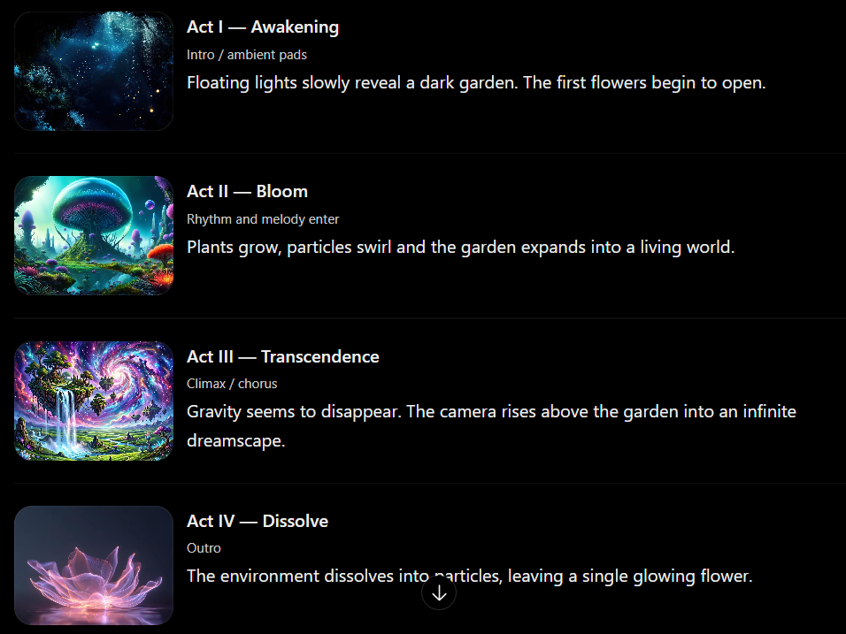
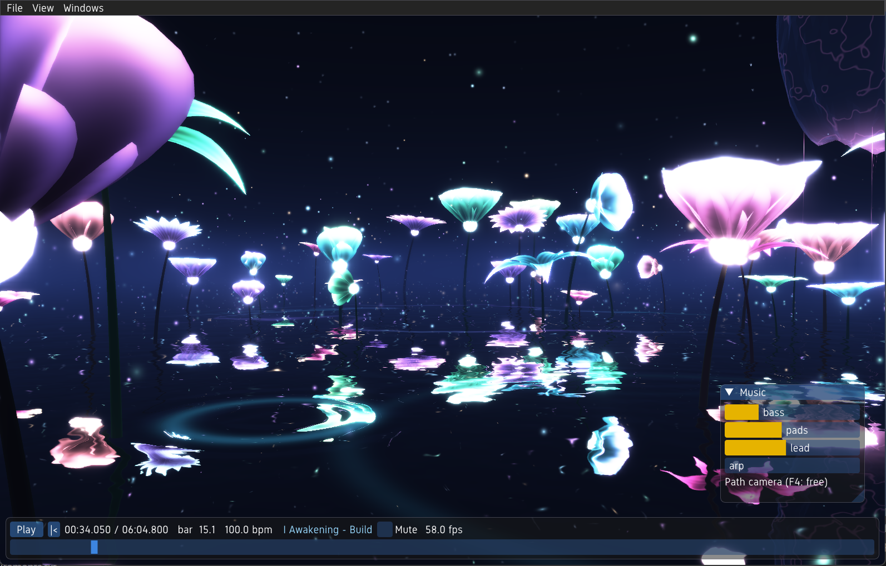
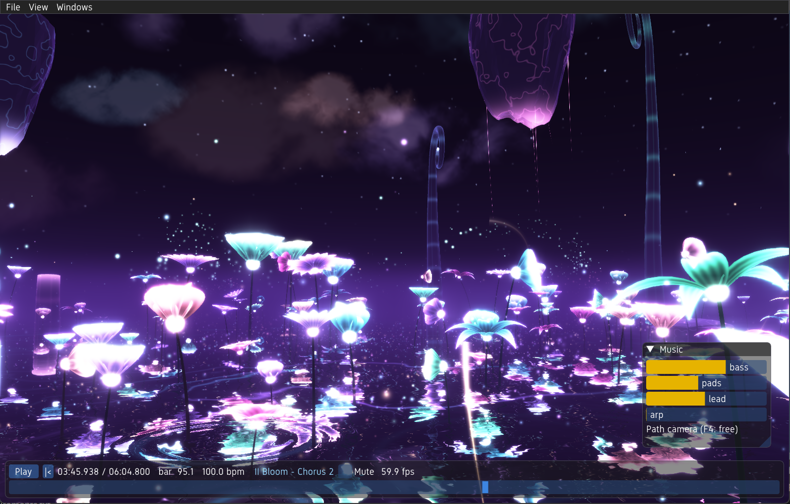
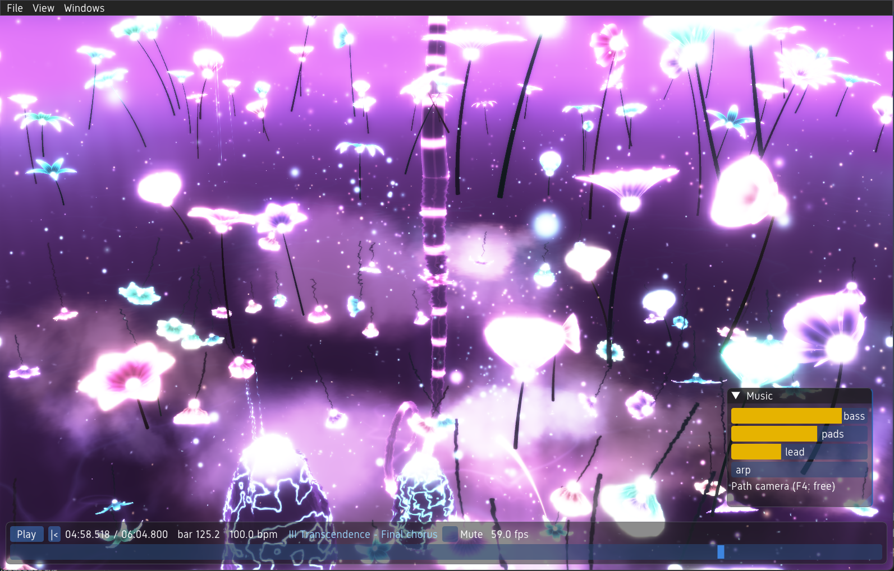
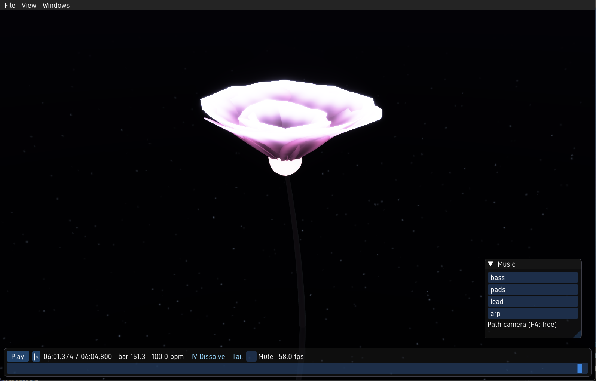

# Creative coding with C++ in the age of AI


I have been exploring creative coding with C++ for some time now, experimenting with various graphics libraries and frameworks to create interactive and generative visual experiences. I started using the libCinder library, which provides a rich set of tools for creative coding, and have also experimented with openFrameworks and Raylib for different types of projects. Recently I have also started to add features to my graphics library, ivf2, so that it becomes my go-to choice for making my own creative works. A couple of years ago I wouldn't have dreamed of developing my own library for creative coding. I just didn't have time to spend on it. With the advent of AI coding assistants the situation has changed completely, both for library development and for how you can create new works. This post describes the flow I used to create my latest demo, Heaven.

<!-- more -->

## Why creative coding?

Creative coding for me is the process of writing code not for solving some scientific problem, but as a way of producing audiovisual experiences, art. I love going from an algorithm to something that produces beautiful moving images on screen. 

At work I support the scientific community by providing guidance in how to write optimised and efficient code. Creative coding has a similar process. You really need to write optimised and efficient code to keep the frame rate at 60 frames per second. A reduced frame rate directly impacts the experience of the work. 

## Why C++?

I started creative coding using the Processing environment. Processing is one of the first tools developed for creative coding. It is based on a simplified form of Java and works well for most creative coding needs. I just felt that you quickly hit limits in what you could do with the tool, so I started trying out libCinder and openFrameworks and saw what performance you could achieve by using C++ instead of Java.  

## Why develop my own creative coding library?

However, using these libraries I always hit some kind of barrier. The design of these libraries was often geared towards adding functionality through plugins, but you often run into problems when you start combining these plugins. Some things you want to implement can also be hard to implement as the libraries have their own rendering model that can be complicated to extend. 

I have written about my graphics library, ivf2, before on this blog. At first it was developed as a replacement for an older library, Ivf++, but it has developed in a different direction. Now it has become the library I use for creative coding. As I am the author of the library I have full control of its inner workings. If I am missing a feature I can just add it, and if something is not implemented right I can change it. 

By using AI I have been implementing more and more advanced features in the library and now it is starting to achieve parity with features you have in other libraries such as openFrameworks and libCinder. Today it is a complete 3D library in modern OpenGL supporting advanced rendering, UI, audio and MIDI, something I could never have built on my own in my spare time.

The library was just the first step...

## What has changed with AI

During 2026 the AI coding models have developed significantly. It is now possible for the AI to quickly implement complete new features in my library. Some features I have recently implemented in ivf2 are:

- Shadow rendering
- Support for ImGui for user interfaces
- Post-processing FX using shaders
- Time-driven animation
- Selection
- Music-driven scenes
- Shader materials

My flow for adding features is first to have a discussion on how a certain feature should be implemented and then ask the AI for a plan to implement it. You don't have to give much guidance. It even instruments the code to take screenshots to verify that the new feature works.  

For creative coding AI enables you to quickly go from a high level idea to a C++ implementation. This is actually a very important aspect especially with regards to creativity. Getting stuck on implementation details of build systems is really not very good for your creativity. In the following sections I will describe my creative process and how I implemented the Heaven demo using AI and ivf2.

## Implementing the Heaven demo

The idea for the demo started with a song I had written, a synthwave-style trance track. The idea was to create an interactive 3D experience instead of the videos I usually create for my songs. I also wanted a single evolving scene instead of fixed scene cuts. Another requirement was that the experience should react to the music track. 

To create the storyboard and to get ideas I started with a conversation with ChatGPT, asking for ideas for a "dreamy lush Paranoid Frog song" (Paranoid Frog is the name I release my music under). It created some images for a dark scene with glowing plants.



It also described how to implement the flowers as procedural geometry. 

In the next step I opened Claude Code in VS Code and asked it to set up a skeleton ivf2 application, which it did including verifying that it could run and find the ivf2 library. 

Then I gave Claude Code the session from ChatGPT (Pasted the session text) and asked it what would be required to implement the proposed storyboard in ivf2. I also asked it for a plan to add any missing features to the library. It developed a plan and implemented the following new features in ivf2:

- An audio manager
- Fog effect
- Planar reflections
- Frame export

We are now at the point where we can start implementing the demo. I didn't want this to be a one-off project, so I instructed Claude to put all generic demo code in a separate library so that it could be used in future demos. I also asked it for a plan for how to implement the demo. The plan went through a couple of iterations, then I asked it to implement the plan. This is where it gets really interesting. Claude didn't just write a quick single-file sketch; it structured the demo like a real software project. Claude:

- Implemented every component of the scene as separate modern C++20 classes.
- Used the ivf2 classes for implementing an OpenGL window and core functionality.
- Put all the generic demo functions in a separate library.
- Added a demo configuration system using JSON.
- Added command line arguments for running in full screen.
- Added functionality for exporting each frame as an image for generating a video file from the demo.

Here are some examples of the generated code:

### FlowerField effect

Each visual element of the scene is its own class. The `FlowerField` builds the procedural flower meshes and places them on the lake, using one instanced node per flower species so that thousands of flowers can be drawn efficiently. A `keepClear` callback keeps the camera path free from flowers.

```cpp
class FlowerField {
public:
    /**
     * @brief Build meshes, material and placements.
     * @param vertexShader Path of flower.vert.
     * @param fragmentShader Path of flower.frag.
     * @param keepClear Returns true for lake positions (x, z) where no flower may
     *                  grow, e.g. along the camera path.
     * @return false if the shaders failed to compile.
     */
    bool create(const std::string &vertexShader, const std::string &fragmentShader,
                const std::function<bool(glm::vec2)> &keepClear = {});

    /** @brief Add flowers growing on floating islands; call after create(). */
    void addIslandFlowers(const std::vector<IslandFlowerSpot> &spots);

    /** @brief Scene nodes to add (one instanced node per species). */
    [[nodiscard]] const std::vector<ivf::InstancedMeshNodePtr> &nodes() const { return m_nodes; }

    [[nodiscard]] ivf::ShaderMaterialPtr material() const { return m_material; }

    /** @brief The flowers of the lake (not those on islands), as instanced. */
    [[nodiscard]] const std::vector<FlowerPlacement> &placements() const { return m_placements; }

private:
    std::vector<FlowerPlacement> m_placements;
    std::vector<ivf::InstancedMeshNodePtr> m_nodes;
    ivf::ShaderMaterialPtr m_material;
};
```

### Main program

The main program is tiny. All it does is point the generic music scene library at the audio file, the score with tempo and note events, and the timeline describing the acts of the demo. The library takes care of the window, audio playback and timing.

```cpp
#include "heaven_window.h"

int main(int argc, char **argv)
{
    ivfmusic::MusicSceneConfig config;
    config.title = "Paranoid Frog - Heaven";
    config.audioFile = "assets/heaven.mp3";
    config.scoreFile = "assets/heaven.xrns"; // tempo and note events
    config.automationFile = "assets/heaven_timeline.json"; // acts and scene parameters

    return ivfmusic::run<heaven::HeavenWindow>(config, argc, argv);
}
```

### Scene window class

The `HeavenWindow` class ties everything together. It derives from a generic music scene window and overrides hooks for setup, per-frame updates, the debug UI and the camera path. The `TrackEnvelope` members follow individual instruments in the song, such as bass, pads and kick, and drive the visual effects.

```cpp
/**
 * @class HeavenWindow
 * @brief The Dreaming Garden: a glowing garden on a dark lake, driven by the song.
 */
class HeavenWindow : public ivfmusic::GLFWMusicSceneWindow {
public:
    explicit HeavenWindow(const ivfmusic::MusicSceneConfig &config);

protected:
    int onSceneSetup() override;
    void onSceneUpdate(double time, double dt) override;
    void onSceneUi() override;
    std::optional<ivf::TimelineCamera> cameraAt(double time) const override;

    /** @brief Musical controls at a song time; a pure function of time. */
    MusicState musicAt(double time) const;

private:
    void updateRings(double time);

    /**
     * @brief A spot on the water ahead of the camera at a note's time, hashed from the
     *        note time so it is the same on every run.
     * @param nearest,farthest Distance range ahead of the camera.
     * @param width Sideways spread.
     * @param salt Varies the placement between effects.
     */
    glm::vec2 spotAhead(double noteTime, float nearest, float farthest, float width, uint32_t salt) const;

    ivfmusic::TrackEnvelope m_bass;
    ivfmusic::TrackEnvelope m_pads;
    ivfmusic::TrackEnvelope m_lead;
    ivfmusic::TrackEnvelope m_arp;
    ivfmusic::TrackEnvelope m_kick;      ///< Note source for the rings on the water and the waves of light.
    ivfmusic::TrackEnvelope m_leadNotes; ///< Note source for the light trails.
    ivfmusic::TrackEnvelope m_bellNotes; ///< Note source for the rings from the last flower (outro).
    ivfmusic::TrackEnvelope m_stab;
    ivfmusic::TrackEnvelope m_clap;
    MusicState m_music;

    FlowerField m_flowers;
    Motes m_motes;
    Swirls m_swirls;
    LightTrails m_trails;
    Islands m_islands;
    Giants m_giants;
    Clouds m_clouds;
    Embers m_embers;
    LakeMaterialPtr m_lake;
    ivf::BlendShaderMaterialPtr m_sky;
    ivf::FogEffectPtr m_fog;
    ivf::MipBloomEffectPtr m_glow;
};
```

### Screenshots

Below are some screenshots taken at different parts of the demo. They show the window with the debug interface visible, which is useful when you want to debug the demo. 



*Act I, Awakening: the first glowing flowers on the dark lake.*



*Act II, Bloom: the flower field in full bloom under the floating islands.*



*Act III, Transcendence: the final chorus, with the whole scene bathed in light.*



*Act IV, Dissolve: everything fades away until only the last flower remains.*

## Lessons learned

One thing that is important when using AI coding tools is to control the workflow. Develop plans. Don't let it freely implement things. You need to be in the driver's seat.

Another thing I noticed is that even though Claude can check its own work, it is not always good at spotting things that look bad. You constantly need to point out things that are not going to plan. One example was the planar surface didn't blend well to the horizon. It said it fixed it several times, but it still wasn't good. 

Remember that you control the results.

## Conclusion

This demo was an eye-opener for me. Back in May 2026 Claude would not have been capable of implementing complete features like this. I was also impressed how well it works in a creative coding session. You give it an idea of how a scene should look and it can quickly suggest how this scene could be implemented. 

Having your own graphics library also helps a lot as you can update and change it to suit your creative coding style. 

The complete video and track can be found here:

<iframe width="800" height="450" src="https://www.youtube.com/embed/68U4Wvhdvxs" title="YouTube video player" frameborder="0" allow="accelerometer; autoplay; clipboard-write; encrypted-media; gyroscope; picture-in-picture; web-share" referrerpolicy="strict-origin-when-cross-origin" allowfullscreen></iframe>

[Watch on YouTube](https://youtu.be/68U4Wvhdvxs)

